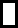

# `loschickenman@github`

---

## `$ neofetch`

<table>
<tr>
<td bgcolor="#0D1117">

<pre>
loschickenman@github:~$ neofetch
</pre>

<table>
<tr>
<td width="45%" align="center">

<pre>
               :: :::
               =+:: :.
               =-=:.:
            .:-+:+==-.
          .-==-=-=--==-.
       .:-==::::::::::-=-:.
     :+*##-:::-::::::::-###+:
    .*##*-:-:-=:::::::=:-*##*.
    .*#*+:-=:--:::::::=-:+*#*.
     +##-:=::=-::::::::=::##*
     =#+:--::+-:::-::::--:+#+
     -#=:=::-=-:::===:::=-=#-
     .*=:=-:=--:::+=+-::=:=*:
     .==:++--.=:::+=.---=:==:
     -=-:+:=--+-::=+=:=+=--=-
     ==--+-*+*+++-=+*+**+--==
    .==:-=+:+**--:=***:+*-:==.
    :==::+-:***.   +**=:+-:==:
    -==::=.:+=+    ==+-.=::==-
    -==::-..==-::::-==..=::-==
    =+=:::=::.-+--=- ::=-::=+=
    -+=:::--  :==-=:  -=:::=+=
    -*+---:=-. :--: .:=::=-+*-
    .+=*==::+==----=-+-:==*=+:
     :.:=++:=: .....:=:++=-.:
         .-=+:      :+=-.
           .-.      .=.

</pre>

</td>
<td width="55%">

<pre>
loschickenman@github
────────────────────────────────────
Name:       Striker
Role:       Backend or systems engineer
Uptime:     2 years, 1 month on GitHub
Languages:  Python

About
────────────────────────────────────
sleep deprived

Contact
────────────────────────────────────
GitHub:     github.com/loschickenman

GitHub Stats
────────────────────────────────────
Repos:          2
Stars:          0
Followers:       0
Following:       0
Contributions:  26
Active days:    4
Streak:         0d
Best streak:    2d
</pre>

</td>
</tr>
</table>

<pre>
loschickenman@github:~$ 
</pre>

</td>
</tr>
</table>

---

## `$ ls ~/projects`

<table>
<tr>
<td bgcolor="#0D1117">

<pre>
$ ls ~/projects
</pre>

<table>
<tr>
<td>📁</td>
<td><a href="https://github.com/loschickenman/CanSat-code"><b>CanSat-code/</b></a></td>
<td>Code for my team's CanSat system</td>
<td>★ 0</td>
</tr>
<tr>
<td>📁</td>
<td><a href="https://github.com/loschickenman/EncryptMe-Personal-Project"><b>EncryptMe-Personal-Project/</b></a></td>
<td>Personal coursework project</td>
<td>★ 0</td>
</tr>
</table>

<pre>
loschickenman@github:~$ 
</pre>

</td>
</tr>
</table>

---

## `$ cat languages.txt`

<table>
<tr>
<td bgcolor="#0D1117">

<pre>
$ cat languages.txt
</pre>

<table>
<tr>
<td><b>Python</b></td>
<td>

</td>
</tr>
</table>

<pre>
loschickenman@github:~$ 
</pre>

</td>
</tr>
</table>

---

## `$ git log --since=26.weeks`

<table>
<tr>
<td bgcolor="#0D1117">

<pre>
$ git log --since=26.weeks
</pre>

<table>
<tr>
<td width="65%">

</td>
<td>

<pre>
STREAK
0 days

LONGEST
2 days

COMMITS THIS YEAR
26
</pre>

</td>
</tr>
</table>

<pre>
loschickenman@github:~$ 
</pre>

</td>
</tr>
</table>

---

## `$ cat links.txt`

<table>
<tr>
<td bgcolor="#0D1117">

<pre>
$ cat links.txt
</pre>

<table>
<tr>
<td>🌐</td>
<td><a href="https://github.com/loschickenman">GitHub</a></td>
<td>Repositories, projects, and contributions</td>
</tr>
</table>

<pre>
loschickenman@github:~$ 
</pre>

</td>
</tr>
</table>

---

<code>~/links</code>

<a href="https://github.com/loschickenman">GitHub</a>

  

Striker · Neofetch-inspired profile

